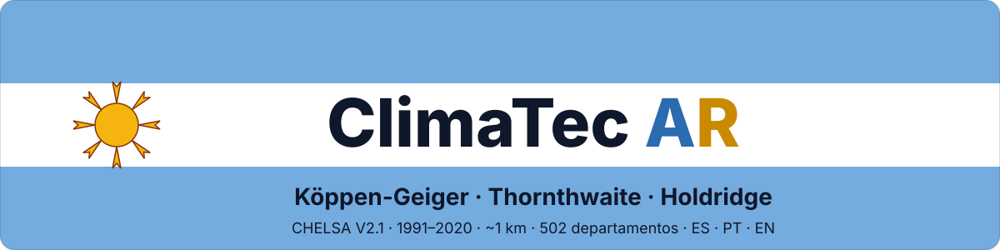

<div align="center">

<a href="https://fcoliveira-utfpr.github.io/climate_argentina/"></a>

# 🇦🇷 ClimaTec AR

### Argentina's climate, pixel by pixel and department by department

<a href="https://fcoliveira-utfpr.github.io/climate_argentina/"></a>
<a href="https://fcoliveira-utfpr.github.io/climate_argentina/?secao=atlas"></a>
<a href="https://fcoliveira-utfpr.github.io/climate_argentina/mapa.html?sistema=koppen"></a>


[](https://github.com/fcoliveira-utfpr/agrometeorologiapy)
[](https://chelsa-climate.org/)
[](#-methodology)
[](#-languages)

| 🌧️ **Köppen-Geiger** | 💧 **Thornthwaite** | 🌳 **Holdridge** |
|:---:|:---:|:---:|
| 22 classes | 9 moisture classes | 29 life zones |
| [Open map →](https://fcoliveira-utfpr.github.io/climate_argentina/mapa.html?sistema=koppen) | [Open map →](https://fcoliveira-utfpr.github.io/climate_argentina/mapa.html?sistema=thornthwaite) | [Open map →](https://fcoliveira-utfpr.github.io/climate_argentina/mapa.html?sistema=holdridge) |

</div>

Climate classifications of **Köppen-Geiger**, **Thornthwaite** and **Holdridge life zones** for all of
Argentina, computed at each ~1 km pixel (≈ 4.0 million pixels) from the **1991–2020** climatological normals of
**CHELSA V2.1**, using the [`agrometeorologiapy`](https://github.com/fcoliveira-utfpr/agrometeorologiapy) library,
and summarized by **department / partido** (502) and **province** (23 + Ciudad Autónoma de Buenos Aires).
This is the Argentine version of [ClimaTec PY — climate_paraguay](https://fcoliveira-utfpr.github.io/climate_paraguay/)
and [ClimaTec Data — climas_brasil](https://fcoliveira-utfpr.github.io/climas_brasil/), with the same methodology.

<p align="center"></p>

## 📑 Contents

- [What the site offers](#️-what-the-site-offers)
- [Main results](#-main-results)
- [File structure](#-file-structure)
- [Data format](#-data-format)
- [Methodology](#-methodology)
- [Validation and uncertainty](#-validation-and-uncertainty)
- [Reproducing the processing](#-reproducing-the-processing)
- [Languages](#-languages)
- [Local use](#-local-use)
- [Data sources and references](#-data-sources-and-references)
- [Authorship](#-authorship)

<p align="center"></p>

## 🗺️ What the site offers

| Page | Content |
|---|---|
| [Home](https://fcoliveira-utfpr.github.io/climate_argentina/) | Introduction, **Maps** and **Atlas** tabs |
| [Köppen-Geiger](https://fcoliveira-utfpr.github.io/climate_argentina/mapa.html?sistema=koppen) | Interactive map of the Köppen-Geiger classification |
| [Thornthwaite](https://fcoliveira-utfpr.github.io/climate_argentina/mapa.html?sistema=thornthwaite) | Moisture, seasonal variation, thermal efficiency and summer concentration |
| [Holdridge](https://fcoliveira-utfpr.github.io/climate_argentina/mapa.html?sistema=holdridge) | Holdridge life zones |

On each map:

- **pixel-by-pixel** classification (~1 km) with department and province boundaries overlaid;
- filters by **province** and **department / partido**, and an **opacity** control;
- when clicking a department: **all climates in the department** with the % of area of each, **climate indices**,
  **interannual stability** of the class, **monthly climograph** (precipitation, PET and mean temperature) and **CSV** download;
- **climate at the clicked point**, read from the ~1 km layer (for Thornthwaite, the full climate type of the point);
- direct link to a department and to a point: `mapa.html?sistema=koppen&departamento=ARG.13.11_1&ponto=-35.47,-69.58`
  (GADM `GID_2` code; latitude, longitude).

The **Atlas** brings together 24 national maps (classifications, climatological variables, validation, stability and
sensitivity), in all three languages.

<p align="center"></p>

## 📊 Main results

Percentage of the country's area (unfiltered classification):

| Classification | Result |
|---|---|
| 🌧️ **Köppen-Geiger** | Cfa 26.0% · BSk 24.7% · Cwa 13.9% · BSh 8.1% · Cfb 6.2% · ET 5.2% · BWk 3.8% · Csb 3.7% · Cwb 2.9% · BWh 2.1% · Cfc 1.4% · others < 1% |
| 💧 **Thornthwaite** (moisture, AWC = 100 mm) | E 35.4% · D 34.1% · C1 23.1% · C2 2.7% · B1 1.4% · B2 1.1% · A 1.0% · B3 0.7% · B4 0.4% |
| 🌳 **Holdridge** (Holdridge PET) | Subtropical dry forest 17.7% · Warm temperate dry forest 15.0% · Warm temperate thorn steppe 13.8% · Warm temperate moist forest 10.1% · Subtropical moist forest 9.7% · Cool temperate steppe 8.2% · Cool temperate desert bush 7.4% · 22 other zones |

The pattern follows the two main gradients of the country: rainfall decreasing from the northeast (Misiones,
> 1,800 mm/year) to the arid diagonal and the Patagonian plateau (< 300 mm/year), and temperature decreasing with
latitude and altitude (subtropical north, temperate Pampas, cold Patagonia, tundra and ice in the high Andes and
Tierra del Fuego).

| City | Köppen | Thornthwaite | Holdridge |
|---|---|---|---|
| La Quiaca | Cwb | DdA′a′ | Cool temperate steppe |
| Salta | Cwb | DdA′a′ | Warm temperate dry forest |
| Posadas | Cfa | B1rA′a′ | Subtropical moist forest |
| Córdoba | Cwa | DdA′a′ | Warm temperate dry forest |
| Mendoza | BWk | EdA′a′ | Warm temperate desert bush |
| Buenos Aires | Cfa | C2rA′a′ | Warm temperate moist forest |
| Neuquén | BWk | EdA′a′ | Warm temperate desert bush |
| San Carlos de Bariloche | Csb | C2s2B′4a′ | Cool temperate wet forest |
| Comodoro Rivadavia | BSk | EdA′a′ | Warm temperate thorn steppe |
| Ushuaia | ET | B1rB′1a′ | Boreal wet forest |

> ⚠️ With CHELSA's Penman-Monteith PET, Thornthwaite's thermal efficiency is megathermal (A′) in 87.5% of the country,
> including windy Patagonia, where the annual PET exceeds 1,140 mm. Thermal differentiation only appears in the Andes
> and Tierra del Fuego (B′4 to C′1). As in Paraguay and Brazil, the useful information of the Thornthwaite system is
> in the moisture class and the subtype.

<p align="center"></p>

## 📦 File structure

```
climate_argentina/
│
├── 🌐 Pages
│   ├── index.html                       # home, Maps (iframes) and Atlas (gallery) tabs
│   └── mapa.html                        # interactive map: ?sistema=koppen|thornthwaite|holdridge
│                                        #   &lang=es|pt|en  &departamento=<GID_2>  &ponto=<lat,lon>
├── ⚙️ assets/                           # i18n.js, comum.js, banner.svg, divisor.svg
│
├── 📊 dados/                            # data that feeds the maps
│   ├── departamentos.geojson            # 502 departments/partidos (GADM 4.1, simplified ~300 m)
│   ├── provincias.geojson               # 24 provinces (drawing only)
│   ├── departamentos_koppen.csv         # majority class + Köppen variables per department
│   ├── departamentos_thornthwaite.csv   # climate type + water balance indices per department
│   ├── departamentos_holdridge.csv      # life zone + biotemperature and PET/P ratio per department
│   ├── mensal_departamentos.json        # 1991-2020 monthly normal per department (tas, pr, pet)
│   ├── composicao_departamentos.json    # % of area of each climate in each department, per layer
│   ├── legendas.json                    # code → color and class name (es/pt/en)
│   ├── camadas.json                     # path and geographic bounds of each PNG layer
│   └── camadas/                         # pixel-by-pixel classification (indexed PNG, Web Mercator)
│
├── 📚 atlas/                            # atlas.json + 24 figures in es/ pt/ en/
│
└── 🐍 processamento/                    # full processing chain (Python)
    ├── config.py · classif.py           # settings and vectorized classification helpers
    ├── p01_baixar_chelsa.py             # CHELSA V2.1 monthly download (COG window reads)
    ├── p02_normal.py                    # 1991-2020 normals
    ├── p03_limites.py                   # GADM boundaries and rasterized units
    ├── p04_classificar.py               # Köppen, Thornthwaite and Holdridge per pixel
    ├── p05_estabilidade.py              # annual climate types and interannual stability
    ├── p06_unidades.py                  # department tables, composition and monthly normals
    ├── p07_camadas.py                   # 3x3 mode filter, Web Mercator PNG layers
    ├── p08_validacao.py                 # stations, Beck et al. (2023), TerraClimate, sensitivity, ecoregions
    ├── p09_atlas.py                     # atlas figures (es/pt/en)
    ├── p10_artigo.py                    # extra analyses and figures for the manuscript
    └── executar_tudo.py                 # runs the chain (python executar_tudo.py [first_step])
```

The heavy intermediate data (monthly CHELSA clips, normals, classification GeoTIFFs) are not versioned: they are
published as assets of the repository [Releases](https://github.com/fcoliveira-utfpr/climate_argentina/releases).

<p align="center"></p>

## 🧾 Data format

All CSV files have one row per department and share the columns `id` (GADM code `GID_2`), `provincia` and
`departamento`. `pct_area` is the percentage of the department's area covered by the majority class and
`estabilidad` the mean interannual stability of the class (%). Decimal separator: dot.

| File | Specific columns |
|---|---|
| `departamentos_koppen.csv` | `koppen` (e.g. `Cfa`), `koppen_id` (1–31), `t_anual`, `t_mes_frio`, `t_mes_quente` (°C), `p_anual`, `p_mes_seco`, `pet_anual` (mm), `composicao` (e.g. `BSk 40.1% · Cfb 26.3% · ...`) |
| `departamentos_thornthwaite.csv` | `tipo` (e.g. `C2rA'a'`), `umidade_id`, `subtipo_id`, `termica_id`, `concentracao_id`, `Im`, `Ih`, `Ia` (%), `ETP_anual`, `DEF_anual`, `EXC_anual` (mm), `composicao_umidade` |
| `departamentos_holdridge.csv` | `zona_id` (1–38), `biotemperatura` (°C), `P_anual`, `ETP_anual` (mm; Holdridge PET), `razao_ETP`, `composicao` (zone code and %) |

`composicao_departamentos.json` — `{ "<id>": { "<layer>": [[code, %], ...] } }`, layers `koppen`, `th_umidade`,
`th_subtipo`, `th_termica`, `th_concentracao` and `holdridge`; classes with ≥ 0.5% of the area.

`mensal_departamentos.json` — `{ "<id>": { "tas": [12 values, °C], "pr": [12, mm], "pet": [12, mm] } }`.

<p align="center"></p>

## 🔬 Methodology

Same as [ClimaTec PY](https://github.com/fcoliveira-utfpr/climate_paraguay):

1. **Data.** Monthly CHELSA V2.1 (`tas`, `pr`, `pet`) from 1991 to 2020, read as windows of the remote Cloud
   Optimized GeoTIFFs for Argentina with a 0.5° margin (74.1°–53.1° W, 55.6°–21.3° S; 2,520 × 4,116 pixels).
   PET (Penman-Monteith) does not exist in the source from May/2019 to December/2020: its normal uses 28–29 years.
2. **1991–2020 normal.** Monthly mean per pixel (~1 km).
3. **Classifications**, using the vectorized functions of `agrometeorologiapy`:
   - **Köppen-Geiger** — Alvares et al. (2013), with the f/s/w seasonality of Kottek et al. (2006);
   - **Thornthwaite** — Thornthwaite (1948), Thornthwaite and Mather (1955) water balance, AWC = 100 mm,
     CHELSA Penman-Monteith PET, tables from Aparecido et al. (2016);
   - **Holdridge** — 38 zones from Jungkunst et al. (2021), Holdridge PET = 58.93 × biotemperature.
4. **Maps.** 3×3 mode filter to remove isolated pixels and clipping by the country boundary. Areas and
   department statistics use the **unfiltered** classification.
5. **Departments.** Majority class by area (pixels weighted by cos(latitude)), composition and means of the variables.
   GADM 4.1 spells "Rió" for "Río" (fixed) and splits the partido of San Fernando (Buenos Aires) into its
   Delta islands and continental section (kept as two units).

<p align="center"></p>

## ✅ Validation and uncertainty

| Check | Result |
|---|---|
| Monthly temperature vs. 67 GHCN-Daily stations (1991–2020, same months) | mean bias −0.08 °C, MAE 0.61 °C, r = 0.99 |
| Annual precipitation vs. 53 synoptic stations (NOAA GSOD¹) | median relative bias −5.4%; 28 stations within ±10% |
| Köppen-Geiger vs. Beck et al. (2023), V2, 1991–2020, 1 km | 73.5% of the area (86.4% for the main groups) |
| Same classifications with TerraClimate 1991–2020 | Köppen 60.9% · Thornthwaite moisture 75.9% · Holdridge 55.3% |
| Interannual stability (share of years in the normal's class) | Köppen 49% · Thornthwaite 67% · Holdridge 60% |
| Sensitivity (% of the area that changes class) | T ±0.5 °C: Köppen 6%, Holdridge 11–12%; P ±10%: 9% / 16% / 13–19%; AWC 50–150 mm: < 1%; PET method: Thornthwaite 78%, Holdridge 68% |

¹ GSOD precipitation: only days with a complete total, or without report and without rain/snow occurrence (= 0 mm),
and months with ≥ 27 valid days. GHCN-Daily has almost no usable precipitation series for Argentina, and the
SMN open-data portal does not allow automated download.

<p align="center"></p>

## 🔁 Reproducing the processing

```bash
pip install rasterio numpy scipy pandas geopandas matplotlib pillow requests tqdm "agrometeorologiapy>=0.3.0"
cd processamento
python executar_tudo.py          # ~1.5 h; downloads ~4.6 GB of CHELSA clips to ../dados_brutos/
```

External validation data (GHCN-Daily, GSOD, Beck et al. 2023, TerraClimate, RESOLVE 2017, GADM 4.1) go to
`dados_brutos/externos/` and `dados_brutos/gadm/` (see the scripts for the URLs).

<p align="center"></p>

## 🌍 Languages

Interface, class names and Atlas in **Spanish** (default), **Portuguese** and **English**, chosen with the
ES · PT · EN buttons or in the URL: `?lang=es`, `?lang=pt`, `?lang=en`.

<p align="center"></p>

## 💻 Local use

The pages read the data with `fetch`, so they require a server:

```bash
git clone https://github.com/fcoliveira-utfpr/climate_argentina.git
cd climate_argentina
python3 -m http.server 8000      # open http://localhost:8000
```

```python
import pandas as pd
url = "https://fcoliveira-utfpr.github.io/climate_argentina/dados/departamentos_koppen.csv"
koppen = pd.read_csv(url)
print(koppen["koppen"].value_counts())
```

<p align="center"></p>

## 📚 Data sources and references

**Data**

- **CHELSA V2.1** — Karger, D. N. et al. (2017). *Scientific Data*, 4, 170122. <https://chelsa-climate.org/>
- **GADM 4.1** — administrative boundaries of Argentina. <https://gadm.org/>
- **GHCN-Daily** — Menne, M. J. et al. (2012). *J. Atmos. Oceanic Technol.*, 29, 897–910.
- **NOAA GSOD** — Global Surface Summary of the Day, NOAA NCEI.
- **TerraClimate** — Abatzoglou, J. T. et al. (2018). *Scientific Data*, 5, 170191.
- **Köppen-Geiger 1 km** — Beck, H. E. et al. (2023). *Scientific Data*, 10, 724.
- **Ecoregions 2017** — Dinerstein, E. et al. (2017). *BioScience*, 67, 534–545.

**Methods**

- Alvares, C. A. et al. (2013). *Meteorologische Zeitschrift*, 22(6), 711–728.
- Aparecido, L. E. O. et al. (2016). *Ciência e Agrotecnologia*, 40(4), 405–417.
- Holdridge, L. R. (1967). *Life zone ecology*. Tropical Science Center, San José, Costa Rica.
- Jungkunst, H. F. et al. (2021). *Journal of Plant Nutrition and Soil Science*, 184, 5–11.
- Kottek, M. et al. (2006). *Meteorologische Zeitschrift*, 15(3), 259–263.
- Thornthwaite, C. W. (1948). *Geographical Review*, 38(1), 55–94.
- Thornthwaite, C. W.; Mather, J. R. (1955). *The water balance*. Publications in Climatology, 8(1).

<p align="center"></p>

## 👤 Authorship

**Fabrício Correia de Oliveira** — Federal University of Technology – Paraná (UTFPR), Santa Helena Campus ·
fcoliveira@utfpr.edu.br

Related projects: [climate_paraguay](https://github.com/fcoliveira-utfpr/climate_paraguay) ·
[climas_brasil](https://github.com/fcoliveira-utfpr/climas_brasil) ·
[agrometeorologiapy](https://github.com/fcoliveira-utfpr/agrometeorologiapy)

<p align="center"></p>
<p align="center"><b>🇦🇷 🤝 🇧🇷 UTFPR Santa Helena Campus</b></p>
